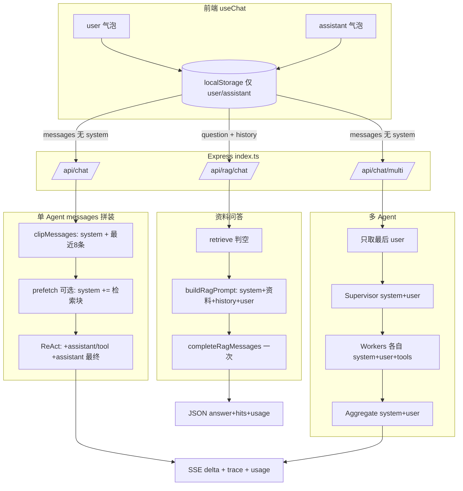

# 项目交互与 messages 拼接说明

> 泳道流程图（方法名 + 调用链）：
>
> - 总览：[messages-assembly-flow.svg](./messages-assembly-flow.svg)
> - 单 Agent：[chat-react-flow.svg](./chat-react-flow.svg)
> - 多 Agent：[chat-multi-flow.svg](./chat-multi-flow.svg)
> - 资料问答：[rag-chat-flow.svg](./rag-chat-flow.svg) · Guard 改动清单：[rag-input-output-guard-changelog.md](./rag-input-output-guard-changelog.md)
> - 人工确认：[human-confirm-flow.svg](./human-confirm-flow.svg)
> - 索引：[flows-index.md](./flows-index.md)

## 一、先记住三层

| 层级 | 存什么 | 有没有 system |
|------|--------|---------------|
| **前端 UI** | `ChatMessage[]`（user / assistant），localStorage | 无 |
| **HTTP 请求体** | 前端发给 API 的 `{ role, content }[]` | 无（普通聊天 / multi） |
| **发给 LLM** | 服务端拼装后的 `messages` | 有，且由服务端注入 |

前端永远只维护 **user / assistant** 对话气泡；**system 不出现在 UI 历史里**。

---

## 二、前端三种模式

```
App.vue / useChat.ts
│
├─ 普通对话（ragMode=false）
│    localStorage: step1-chat:history
│    POST /api/chat 或 /api/chat/multi（当前默认 multi）
│    可选：searchKb 勾选 → body.searchDocs=true
│
├─ 资料问答（ragMode=true）
│    localStorage: step1-chat:rag-history
│    POST /api/rag/chat
│
└─ 展示
     ToolTracePanel（工具过程）
     RagHitPanel（命中 chunk）
     UsagePanel（token）
```

发送时前端只 map 出：

```ts
messages: history.map(({ role, content }) => ({ role, content }))
// 只有 user | assistant，不含 system
```

---

## 三、链路 A：`POST /api/chat`（单 Agent ReAct）

文件：`server/chat.ts` → `clipMessages` → `runConversation` → LangGraph

### 3.1 前端 → 服务端

```json
{
  "messages": [
    { "role": "user", "content": "广州天气" },
    { "role": "assistant", "content": "..." },
    { "role": "user", "content": "顺便查查几点" }
  ],
  "searchDocs": false,
  "model": "deepseek-chat"
}
```

### 3.2 clipMessages 后（发给模型的起点）

`server/clipMessages.ts`：取最近 8 条 user/assistant，**前面固定插一条 system**。

```
[
  { role: "system", content: buildSystemPrompt(searchDocs) },  ← 服务端拼
  { role: "user", ... },
  { role: "assistant", ... },
  { role: "user", ... }   ← 最后一条通常是本轮问句
]
```

`buildSystemPrompt(searchDocs)` 组成（`server/chat.ts`）：

```
SYSTEM_PROMPT                    工具规则（天气/时间/…）
+ SYSTEM_PROMPT_KB_ON/OFF        本轮是否开了「搜索知识库」
+ SYSTEM_PROMPT_GUARD              防注入
```

### 3.3 勾选「搜索知识库」时（prefetch，仍在 ReAct 前）

`prefetchSearchDocsIfEnabled` 不改 messages 结构，只**追加到 system.content**：

```
system.content +=
  【本轮知识库检索结果】...
  [1] id=... source=... title=...
  chunk 原文...
  [2] ...
```

- 判空 → 不调 LLM，直接固定文案回复
- 有资料 → 继续 ReAct

### 3.4 ReAct 循环中 messages 如何变长

LangGraph：`askModel` ↔ `applyTools` → `reply`

每一轮 **askModel** 可能追加：

```
{ role: "assistant", content: null, tool_calls: [...], reasoning_content?: ... }
{ role: "tool", tool_call_id: "...", content: "{...json...}" }
{ role: "tool", tool_call_id: "...", content: "{...json...}" }
... 再问模型 ...
{ role: "assistant", content: "最终给用户看的文字" }  ← 无 tool_calls，结束
```

**注意**：`assistant+tool_calls` 和 `role:"tool"` 只存在于**本轮请求内存**，不会写回前端 localStorage。

### 3.5 返回前端（SSE）

| 事件 | 含义 |
|------|------|
| `tool_call` / `tool_result` | 过程面板 |
| `delta` | 最终文字（可能一次性整段） |
| `usage` | token 统计 |
| `[DONE]` | 结束 |

---

## 四、链路 B：`POST /api/chat/multi`（多 Agent）

文件：`server/index.ts` → `graph.ts`

### 4.1 前端 → 服务端

body 同样带 `messages[]`，但服务端**几乎只用最后一条 user**：

```ts
const lastUser = [...messages].reverse().find(m => m.role === "user");
// graph.invoke({ userMessage: lastUser.content, ... })
```

历史 user/assistant **当前未传入** Supervisor（设计简化）。

### 4.2 内部 LLM 调用（各自独立 messages，不是一条长 chat 史）

| 节点 | 发给 LLM 的 messages 形状 |
|------|---------------------------|
| Supervisor | `[system 路由规则, user 本轮问句]` + route tool |
| Worker | `[system Worker 专用, user 子任务]` + 工具 schema |
| Aggregate | `[system 汇总规则, user 各 Worker 输出]` |

Worker 内部 mini ReAct 也会出现 `assistant+tool_calls` + `tool` 回填，逻辑同单 Agent，但**隔离在 Worker 内**。

### 4.3 返回前端（SSE）

```
supervisor_route → worker_done × N → delta → usage → [DONE]
```

前端 **ToolTracePanel 默认只认单 Agent 的 tool_call 事件**，multi 的过程事件类型不同。

---

## 五、链路 C：`POST /api/rag/chat`（资料问答）

文件：`server/routes/ragChat.ts` → `server/rag/answer.ts` → `buildRagPrompt`

响应形态：**SSE**（与 chat / multi 对齐）。

安全 + 可观测（与 chat 对齐语义）：
- **Input**：`detectInjection(question)` → 只标记；SSE `injection_detected`
- **Tool**：检索前 `validateToolCall("searchDocs", { question })`；拒绝则 `tool_result.error`、不 retrieve
- **Output**：`detectLeakage` → 可能换 safeText；SSE `output_leak_blocked`
- **SSE Trace**：`tool_call` / `tool_result` / 防护事件 → ToolTracePanel；命中另发 `rag_meta` → RagHitPanel
- **LangSmith**：`rag-request` → `rag-retrieve` → `rag-llm`（需 tracing 开关）
- **Token**：`bindUsage("rag")` → `writeUsageToStream`

改动清单：[rag-input-output-guard-changelog.md](./rag-input-output-guard-changelog.md)

### 5.1 前端 → 服务端

```json
{
  "question": "不要把整篇文档塞进 prompt 冒充 RAG",
  "history": [
    { "role": "user", "content": "..." },
    { "role": "assistant", "content": "..." }
  ],
  "model": "..."
}
```

- `question` = 当前问句（单独字段）
- `history` = **不含**当前问句的 prior 对话

### 5.2 buildRagPrompt 后（一次 LLM 调用）

检索经 toolGuard 通过且判空通过后：

```
[
  {
    role: "system",
    content: RAG_SYSTEM_PROMPT + "\n\n## 资料\n\n" + [1]...[2]... chunk 原文
  },
  ...history 里最近 6 条 user/assistant...,
  { role: "user", content: question }
]
```

- **独立 system**：不用 chat.ts 那份工具 system
- **不把天气等业务 tools 交给模型**；检索本身在服务端按 `searchDocs` 过 ToolGuard
- 一次 `completeRagMessages` → 整段答案经 SSE `delta` 推一次

### 5.3 SSE 回前端（顺序）

```
injection_detected? → tool_call → tool_result → output_leak_blocked?
→ rag_meta{ empty, hits, … } → delta(answer) → usage? → [DONE]
```

`rag_meta.hits` → RagHitPanel；`delta` → assistant 气泡；过程事件 → ToolTracePanel。

---

## 六、三种链路对比（messages 视角）

| | `/api/chat` | `/api/chat/multi` | `/api/rag/chat` |
|--|-------------|-------------------|-----------------|
| 前端 history | user/assistant | user/assistant（服务端 mostly 忽略） | prior user/assistant + question |
| system 谁拼 | clipMessages + chat.ts | 各节点各自 system | rag/prompt.ts RAG_SYSTEM |
| 知识库资料放哪 | 追加到 system（prefetch） | kb Worker 内部 | 追加到 system（## 资料） |
| tool 角色 | assistant+tool_calls + tool | Worker 内部同上 | 服务端检索按 searchDocs 过 Guard（模型无 tools） |
| 多轮 LLM | ReAct 1~5 次 | Supervisor+Workers+Aggregate | 通常 1 次 |
| 响应格式 | SSE | SSE | SSE |
| Input/Output Guard | detectInjection + detectLeakage（SSE） | 同左 | 同左 |
| Tool Guard | applyToolCalls | runToolSafely | validateToolCall(searchDocs) |
| LangSmith | ✅ chat-request | ✅ multi-request | ✅ rag-request |

---

## 七、Mermaid 总览



---

## 八、相关源码索引

| 话题 | 文件 |
|------|------|
| 前端发请求 | `src/composables/useChat.ts`, `src/api/chat.ts`, `src/api/rag.ts` |
| 截断 + 注入 system | `server/clipMessages.ts`, `server/chat.ts` |
| 搜索知识库 prefetch | `server/react/prefetchSearchDocs.ts` |
| ReAct + tool 回填 | `server/react/runConversation.ts`, `applyToolCalls.ts` |
| 多 Agent | `server/multi-agent/graph.ts` |
| RAG prompt | `server/rag/prompt.ts`, `server/rag/answer.ts` |
| 回答风格收敛 | `server/answer-style/knowledgeAnswer.ts` |
