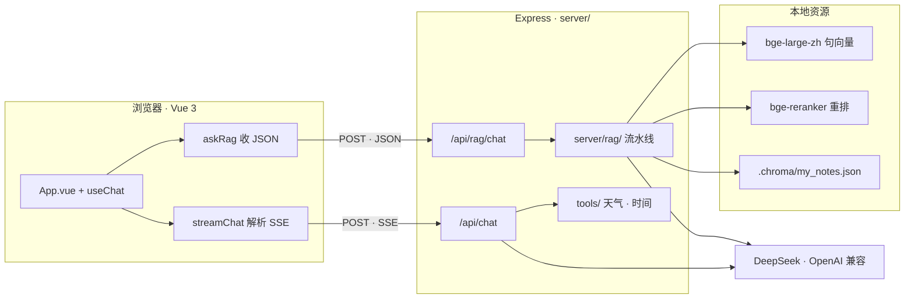
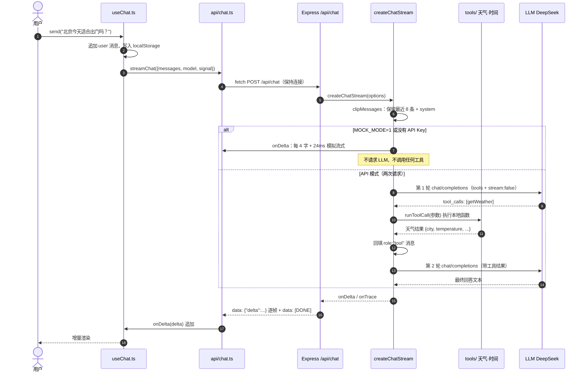
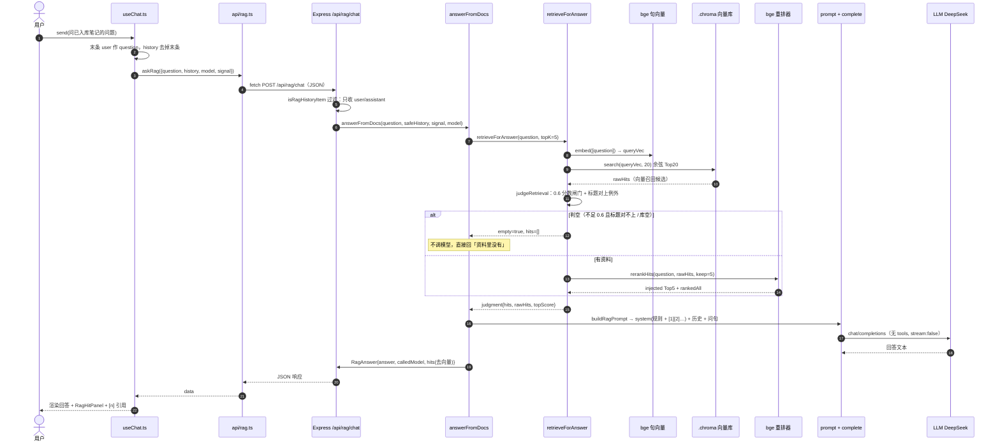
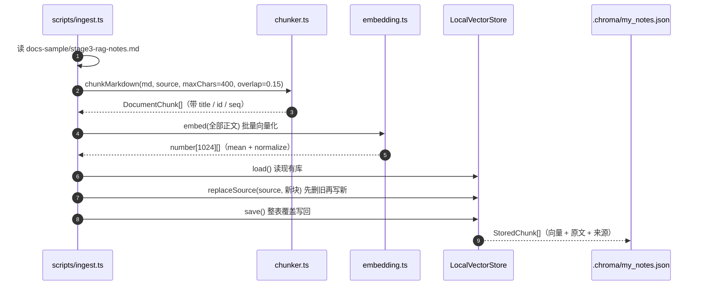
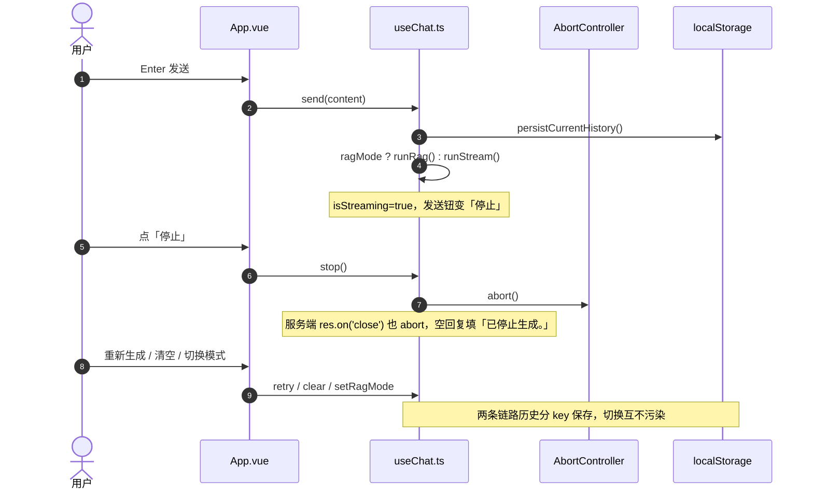
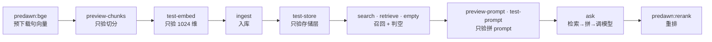

# step1-chat · 模块时序图（mermaid 源码）

> **不想看源码、想直接看图？** 打开 `diagrams/index.html`（浏览器即可，无需任何渲染器），
> 或逐个打开 `diagrams/*.svg`。本 `.md` 是 mermaid 源码：
> 在 VS Code（Markdown Preview Mermaid Support）或 GitHub 上直接渲染；也可粘贴到 https://mermaid.live 编辑。
> 终端可直接阅读的 ASCII 版由 `scripts/gen-seq-diagrams.mjs` 生成，SVG 版由 `scripts/render-seq-svg.mjs` 生成。

## 图 1 · 架构与数据边界

两条链路共用前端状态与 Express，但接口、协议、system 与历史存储完全隔离；本地模型与向量库只服务资料链路。

## 图 2 · 链路 A：普通对话（SSE + 工具调用）

tool calling 闭环：决定 → 执行 → 回填 → 再问，全程非流式两次请求；前端每次读到 data 帧就渲染一段。

## 图 3 · 链路 B：资料问答（RAG 流水线）

空结果不消耗模型调用；RagHitView 去掉 1024 维向量再回前端，引用编号只认本次注入的 promptIndex。

## 图 4 · 离线入库 rag:ingest

同一 source 只允许一份数据：replaceSource 先删旧再写新，禁止直接 push 造成新旧两版并存。

## 图 5 · 状态与生命周期

watch([messages, isStreaming, ragMode]) 在非流式时把当前模式的历史写回 localStorage，普通对话与资料问答各一份。

## 图 6 · 单点验证脚本顺序

每条命令只练一个环节，失败只重跑那一条；入库成功 ≠ 检索合格，检索有命中 ≠ 可以注入。
