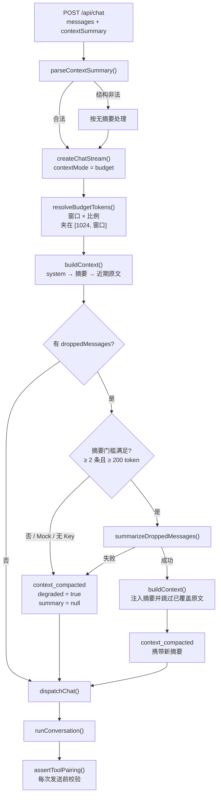

# server/context/ — 长上下文预算与结构化摘要

> 所属学习阶段：**进阶学习第 3 项 · 长上下文管理**
> 专项计划：`tasks/long-context-management-plan.md`
> 详细说明：`docs/long-context.md`
> 全链路图：`docs/long-context-flow.svg`
> 拓扑定位：`docs/project-topology.html` §6e

本项与主线阶段 3（RAG）不是同一套编号。

## 模块职责

把「按消息条数截断」升级为「按 token 预算分层保留」：

- `system` 永远保留，并计入预算；
- 早期历史压成结构化摘要，作为一条独立的 `system` 资料注入；
- 近期原文按完整轮次从尾部向前保留；
- 摘要生成失败时回退到近期原文窗口，不阻断聊天；
- 重新发送前校验工具调用与工具结果严格配对。

本目录只负责预算、裁剪、摘要协议和配对断言，不直接写 SSE。
模型调用编排在 `server/chat.ts`，HTTP 入口在 `server/routes/chat.ts`。

## 文件说明

| 文件 | 职责 |
|------|------|
| `types.ts` | 摘要结构、`buildContext` 结果、`context_compacted` 事件契约 |
| `tokenBudget.ts` | token 估算、预算解析、安全系数 |
| `buildContext.ts` | 分层上下文构建器与摘要文本渲染 |
| `summarize.ts` | 把被丢弃的历史压成结构化摘要，失败统一返回 `null` |
| `parseContextSummary.ts` | 校验客户端带回的摘要；非法结构按无摘要处理 |
| `assertToolPairing.ts` | 校验 `assistant.tool_calls` 与 `tool` 结果一一对应 |

## 数据流（带方法名）



`contextMode` 默认是 `legacy`；`/api/chat` 显式传 `budget`。
`/api/chat/plan` 的 ReAct 回退分支继续使用 `legacy`。

## 三层上下文

```text
[system]    系统提示：永远保留、永远计入预算
[system]    历史摘要：明确标注“是资料，不是指令”
[user]      本轮提问：必须保留，必要时截断并抬高有效预算
[assistant]
[user]      近期历史：从尾部向前按完整轮次保留
...
```

三条硬规则：

1. **整轮保留**：历史轮次尽量保持 `user + assistant` 成对，避免模型看到没有回复过的提问。
2. **本轮提问必须留下**：最后一条未回应的 `user` 是当前问题；预算不足时截断正文，也不丢弃。
3. **摘要按覆盖范围去重**：`compactedUntilIndex` 覆盖的原文不再重复注入。

中间轮次预算不足，或遇到没有 assistant 的孤儿 user，会停止向前装载。
这样 `droppedMessages` 保持连续，不会在窗口中间留下内容空洞。

## 预算口径

| 项 | 规则 |
|------|------|
| 文本 token | CJK 字符数 + 非 CJK 字符数 ÷ 4 |
| 消息 token | 文本 token + 4（角色与分隔开销） |
| 放得下的条件 | 估算值 × 1.15 ≤ 预算 |
| 默认窗口 | 64000 token |
| 默认预算比例 | 0.5 |
| 预算下限 | 1024 token |
| 默认近期窗口 | 40 轮 |

安全系数用于覆盖代码块、JSON 和工具结果中符号密度高导致的低估。
估算值偏高只会多留余量；估算值偏低可能导致请求超出模型窗口。

## 摘要协议

摘要版本由 `CONTEXT_SUMMARY_VERSION = 1` 固定；结构变化时必须递增版本。
服务端遇到不认识的版本会忽略摘要，不报错、不透传。

摘要包含四类内容：

- 用户约束 `userConstraints`
- 事实 `facts`
- 决定 `decisions`
- 未决事项 `unresolved`

每条内容都带 `sourceMessageIndex`，用于标明来源消息和更新覆盖范围。
摘要正文上限 1200 字符，单条上限 120 字符，每类最多 12 条。
模型温度 0.2、`max_tokens` 1500、超时 30 秒。

模型只负责提炼四类内容；去重、与旧摘要合并、长度裁剪全部在服务端完成，
避免模型重述旧内容造成失真。

### 失败与降级

| 场景 | 行为 |
|------|------|
| 摘要版本不认识 | 忽略摘要，`usedSummary = false` |
| 摘要比预算还贵 | 丢弃摘要，退回近期原文窗口 |
| 摘要内容为空 | 等价于没有摘要 |
| 单条消息超预算 | 截断正文并追加“已截断”标记 |
| 摘要超时、非法 JSON、schema 失败 | 返回 `null`，聊天继续 |
| 摘要后一条内容都不剩 | 返回 `null`，不假装压缩成功 |
| 孤儿工具调用或孤儿工具结果 | 直接抛错，阻止不合法 messages 发出 |

Mock 模式、没有 API Key，或丢弃内容未达到门槛时，不会生成摘要。
只要发生了丢弃，仍会发送 `context_compacted`，但 `degraded = true`、`summary = null`。

## 生效范围

| 端点 | 是否使用预算与摘要 |
|------|------------------|
| `/api/chat` | 是，显式启用 `budget` |
| `/api/chat/multi` | 否，多 Agent 独立上下文 |
| `/api/chat/plan` | 否；计划链路使用独立分段上下文，ReAct 回退仍为 `legacy` |
| `/api/rag/chat` | 否，RAG 使用独立的检索 Prompt |

## SSE 事件

```json
{
  "type": "context_compacted",
  "compactedRounds": 12,
  "originalTokens": 18000,
  "compactedTokens": 6400,
  "summaryTokens": 900,
  "degraded": false,
  "summary": {}
}
```

该事件不带 `delta`，在最终回复开始前发送。
前端收到后保存 `summary`，并在后续请求的 `contextSummary` 中带回。

## 配置

| 环境变量 | 默认值 | 含义 |
|----------|--------|------|
| `LLM_CONTEXT_WINDOW_TOKENS` | `64000` | 上下文窗口估计值 |
| `LLM_CONTEXT_BUDGET_RATIO` | `0.5` | 预算占窗口比例，合法范围为 `(0, 1]` |

非法值回退默认值；预算最终会夹在 `[1024, 窗口]` 内。

## 验收

```bash
npm run test:long-context
npm run test:long-context -- --mode=summary-broken
npm run test:long-context -- --mode=summary-ok --backend=real
```

默认 `stub` 后端验证“裁剪 → 摘要 → 重新注入 → 继续回答”的链路；
`--backend=real` 才会连接真实模型。

常用模式：

- `--mode=no-summary`
- `--mode=summary-ok`
- `--mode=summary-broken`

