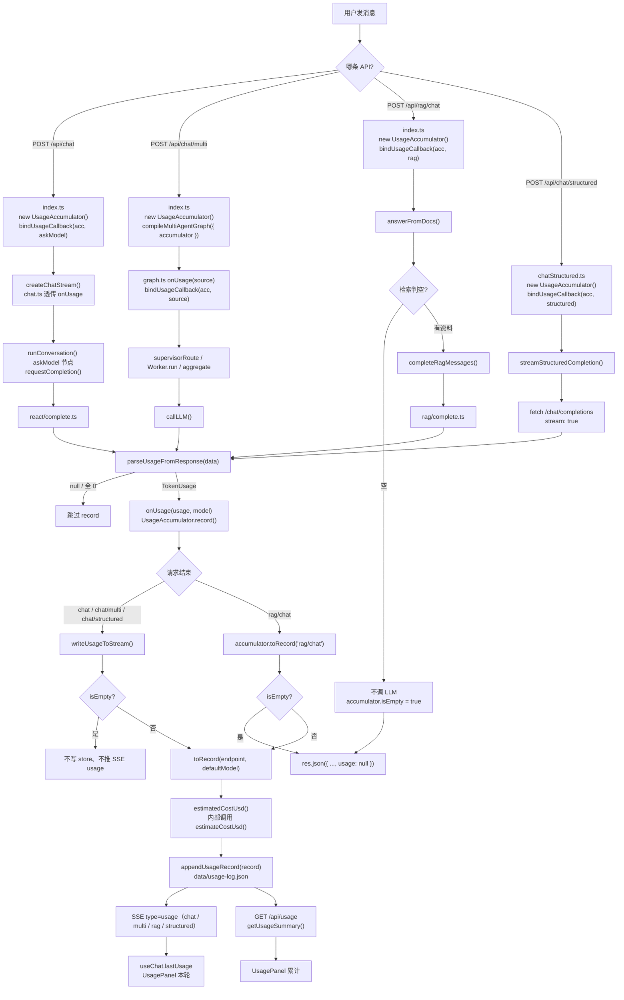
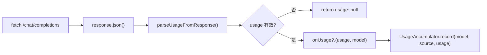
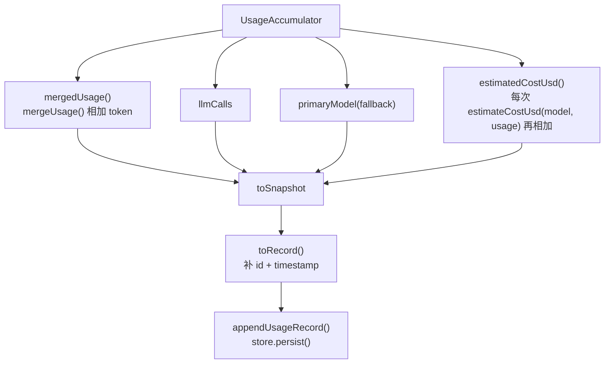
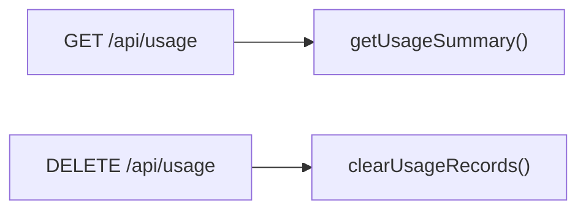

# server/usage/ — Token 统计与成本控制

> 所属学习阶段：**阶段 5 · Token 统计与成本控制（已结）**
> 学习计划：`stage5-token-cost-learning-plan.md` · 动手：`stage5-token-cost-hands-on.md`

## 模块职责

收集每次 API 请求中所有 LLM 调用的 token 用量，估算成本，持久化并提供查询接口。

## 文件说明

| 文件 | 职责 |
|------|------|
| `types.ts` | TokenUsage、UsageRecord、UsageSummary 类型 |
| `parseUsage.ts` | 从 chat/completions 响应解析 usage |
| `pricing.ts` | 按模型单价估算 USD 成本 |
| `accumulator.ts` | 请求级累加器（一次请求多次 LLM 调用） |
| `store.ts` | 内存 + `data/usage-log.json` 持久化 |

## 流程图（带方法名）

SVG 图（浏览器直接打开）：[`diagrams/usage-token.svg`](../../diagrams/usage-token.svg)

一次用户提问 = 一次 HTTP 请求 = **一个** `UsageAccumulator`。内部可能多次 LLM，每次 `record()`，请求结束再合成一条 `UsageRecord`。

### 总览：入口 → 累加 → 落盘 → 前端



### 单次 LLM 调用内部（解析层）

四条封装路径最终都走同一套：



| 封装 | 方法 | source 标签 |
|------|------|-------------|
| `react/complete.ts` | `requestCompletion()` | `askModel` |
| `multi-agent/llm.ts` | `callLLM()` | `supervisor` / `worker` / `aggregate` |
| `rag/complete.ts` | `completeRagMessages()` | `rag` |
| `structured/complete.ts` | `streamStructuredCompletion()` | `structured` |

### 请求结束：合成一条记录



### 查询与清空



## API

- `GET /api/usage` — 汇总 + 最近记录
- `DELETE /api/usage` — 清空记录（demo）

## SSE 事件

请求结束前推送：

```json
{ "type": "usage", "endpoint": "chat", "totalTokens": 640, "llmCalls": 3, "estimatedCostUsd": 0.00012 }
```
