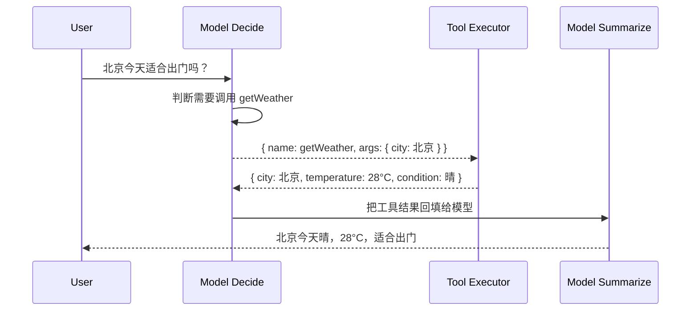

# Tool Calling 完整 Demo

> 这是一个**独立于现有项目**的学习文档，只用于理解 Tool Calling 的协议、调用、结果回填和最终总结。
>
> 目标不是做页面，而是让你看懂一条完整链路：
> 用户输入 -> 模型决定是否调用工具 -> 工具执行 -> 工具结果回填 -> 模型生成最终回答。

---

## 1. 这个 Demo 要解决什么

很多人第一次接触 Tool Calling，会把它理解成“模型直接调用后端接口”。其实不是。

更准确的流程是：

1. 用户发一句话
2. 模型先判断要不要调用工具
3. 如果要，就输出一个结构化的工具调用请求
4. 你的程序收到这个请求后，真正去执行工具
5. 执行结果再作为新消息喂回模型
6. 模型根据工具结果，生成最终自然语言回答

所以 Tool Calling 的本质是：

- 模型负责“决定”和“组织”
- 你的程序负责“执行”
- 最终回复仍然由模型生成

---

## 2. 一次完整对话长什么样

下面是一个最小例子，用户问：

> 北京今天适合出门吗？

模型第一步不直接回答，而是返回工具调用意图：

```json
{
  "tool_name": "getWeather",
  "arguments": {
    "city": "北京"
  }
}
```

你的程序执行工具后，得到：

```json
{
  "city": "北京",
  "temperature": "28°C",
  "condition": "晴",
  "humidity": "42%"
}
```

然后你把工具结果回填给模型，模型最终输出：

> 北京今天晴，28°C，湿度 42%，适合出门，但中午注意防晒。

这就是最小闭环。

---

## 3. 协议的关键消息类型

为了方便理解，这里不用某家 SDK 的私有类型，而是把协议抽象成三个消息类型：

```ts
type Role = "system" | "user" | "assistant" | "tool";

interface BaseMessage {
  role: Role;
  content: string;
}

interface ToolCallMessage {
  role: "assistant";
  content: string;
  tool_call?: {
    name: string;
    arguments: Record<string, unknown>;
  };
}
```

含义如下：

- `system`：固定规则，比如“你是一个天气助手”
- `user`：用户输入
- `assistant`：模型输出
- `tool`：工具执行后的结果

---

## 4. 完整代码 demo

下面是一份**完整的单文件 TypeScript Demo**，你可以把它保存成 `tool-calling-demo.ts`，然后用 `tsx` 运行。

这个 demo 分成三层：

- 模型层：决定是否调用工具
- 工具层：真正执行工具
- 编排层：负责把消息串起来

### 4.1 完整代码

```ts
// tool-calling-demo.ts

type Role = "system" | "user" | "assistant" | "tool";

interface ChatMessage {
  role: Role;
  content: string;
}

interface ToolCall {
  name: string;
  arguments: Record<string, unknown>;
}

interface AssistantMessage extends ChatMessage {
  role: "assistant";
  tool_call?: ToolCall;
}

interface ToolResultMessage extends ChatMessage {
  role: "tool";
  tool_name: string;
}

interface WeatherResult {
  city: string;
  temperature: string;
  condition: string;
  humidity: string;
}

interface TimeResult {
  city: string;
  time: string;
}

const SYSTEM_PROMPT = `
你是一个前端学习助手，负责回答天气和时间相关问题。
如果用户问题涉及天气，请优先调用 getWeather 工具。
如果用户问题涉及某个城市的时间，请优先调用 getTime 工具。
如果不需要工具，直接回答。
请始终输出简洁、准确、可执行的回答。
`.trim();

const TOOL_SCHEMAS = {
  getWeather: {
    name: "getWeather",
    description: "查询某个城市今天的天气情况",
    parameters: {
      city: "string",
    },
  },
  getTime: {
    name: "getTime",
    description: "查询某个城市当前时间",
    parameters: {
      city: "string",
    },
  },
} as const;

function logSection(title: string) {
  console.log(`\n=== ${title} ===`);
}

function pretty(value: unknown) {
  return JSON.stringify(value, null, 2);
}

function extractCity(text: string): string | null {
  const cityPatterns = ["北京", "上海", "广州", "深圳", "杭州", "成都", "南京", "武汉"];
  for (const city of cityPatterns) {
    if (text.includes(city)) return city;
  }
  const match = text.match(/([\u4e00-\u9fa5]{2,8})/);
  return match?.[1] ?? null;
}

function detectIntent(userText: string): ToolCall | null {
  const text = userText.toLowerCase();

  if (text.includes("天气") || text.includes("下雨") || text.includes("温度") || text.includes("气温")) {
    const city = extractCity(userText) ?? "北京";
    return {
      name: "getWeather",
      arguments: { city },
    };
  }

  if (text.includes("时间") || text.includes("几点") || text.includes("现在几点")) {
    const city = extractCity(userText) ?? "北京";
    return {
      name: "getTime",
      arguments: { city },
    };
  }

  return null;
}

async function mockModelDecide(messages: ChatMessage[]): Promise<AssistantMessage> {
  const lastUser = [...messages].reverse().find((m) => m.role === "user");
  if (!lastUser) {
    return {
      role: "assistant",
      content: "我没有收到用户问题。",
    };
  }

  const toolCall = detectIntent(lastUser.content);

  if (toolCall) {
    return {
      role: "assistant",
      content: `我需要调用工具 ${toolCall.name}。`,
      tool_call: toolCall,
    };
  }

  return {
    role: "assistant",
    content: `这是直接回答：我理解你的问题是“${lastUser.content}”，但这个 demo 只演示天气和时间工具。`,
  };
}

async function executeTool(call: ToolCall): Promise<WeatherResult | TimeResult> {
  const city = String(call.arguments.city ?? "北京");

  if (call.name === "getWeather") {
    // 这里用 mock 数据模拟真实天气 API
    return {
      city,
      temperature: city === "北京" ? "28°C" : "24°C",
      condition: city === "北京" ? "晴" : "多云",
      humidity: city === "北京" ? "42%" : "55%",
    };
  }

  if (call.name === "getTime") {
    const now = new Date();
    return {
      city,
      time: now.toLocaleString("zh-CN", { hour12: false }),
    };
  }

  throw new Error(`Unknown tool: ${call.name}`);
}

async function mockModelSummarize(messages: ChatMessage[]): Promise<string> {
  const lastTool = [...messages].reverse().find((m) => m.role === "tool") as ToolResultMessage | undefined;
  if (!lastTool) {
    return "没有工具结果可总结。";
  }

  const data = JSON.parse(lastTool.content) as WeatherResult | TimeResult;

  if (lastTool.tool_name === "getWeather") {
    const weather = data as WeatherResult;
    return `${weather.city}今天${weather.condition}，气温 ${weather.temperature}，湿度 ${weather.humidity}。整体上适合出门，记得做好防晒或带伞。`;
  }

  if (lastTool.tool_name === "getTime") {
    const time = data as TimeResult;
    return `${time.city}当前时间是 ${time.time}。`;
  }

  return "工具结果已收到，但我不知道怎么总结。";
}

function toToolResultMessage(toolName: string, result: unknown): ToolResultMessage {
  return {
    role: "tool",
    tool_name: toolName,
    content: JSON.stringify(result, null, 2),
  };
}

async function runConversation(userInput: string) {
  const messages: ChatMessage[] = [
    { role: "system", content: SYSTEM_PROMPT },
    { role: "user", content: userInput },
  ];

  logSection("1) 初始消息");
  console.log(pretty(messages));

  const assistantDecision = await mockModelDecide(messages);

  logSection("2) 模型第一次输出");
  console.log(pretty(assistantDecision));

  messages.push(assistantDecision);

  if (!assistantDecision.tool_call) {
    logSection("3) 最终回答（无需工具）");
    console.log(assistantDecision.content);
    return;
  }

  logSection("3) 工具执行请求");
  console.log(pretty(assistantDecision.tool_call));

  const toolResult = await executeTool(assistantDecision.tool_call);
  const toolResultMessage = toToolResultMessage(assistantDecision.tool_call.name, toolResult);

  logSection("4) 工具返回结果");
  console.log(pretty(toolResultMessage));

  messages.push(toolResultMessage);

  const finalAnswer = await mockModelSummarize(messages);

  logSection("5) 模型最终回答");
  console.log(finalAnswer);
}

async function main() {
  const input = process.argv.slice(2).join(" ").trim() || "北京今天适合出门吗？";

  logSection("Tool Schemas");
  console.log(pretty(TOOL_SCHEMAS));

  await runConversation(input);
}

main().catch((error) => {
  console.error(error);
  process.exit(1);
});
```

---

## 5. 这份代码怎么理解

### 5.1 `detectIntent`

这一步模拟“模型判断是否要调用工具”。

真实项目里，这部分不应该由你手写规则，而应该由模型输出结构化结果。但为了学习协议，我们先用规则模拟。

它会做两件事：

- 识别用户是不是在问天气或时间
- 提取城市名

返回结果长这样：

```ts
{
  name: "getWeather",
  arguments: { city: "北京" }
}
```

---

### 5.2 `executeTool`

这一步是真正执行工具。

这里没有接真实天气 API，而是用 mock 数据模拟：

- `getWeather` 返回天气结果
- `getTime` 返回当前时间

这个阶段非常重要，因为它让你清楚地看到：

**模型不执行工具，程序才执行工具。**

---

### 5.3 `toToolResultMessage`

工具执行完以后，要把结果转换成一条 `tool` 消息。

这就是“工具结果回填给模型”的动作。

比如：

```ts
{
  role: "tool",
  tool_name: "getWeather",
  content: "{ ... }"
}
```

这一步在真实的 OpenAI 兼容协议里非常关键，因为后续模型要根据这条消息继续生成答案。

---

### 5.4 `mockModelSummarize`

这一步模拟“模型读取工具结果并生成最终答案”。

你可以把它理解成：

1. 模型先问工具
2. 工具给数据
3. 模型再把数据翻译成人类语言

这才是完整的 Tool Calling 闭环。

---

## 6. 这份 Demo 的消息流转图



---

## 7. 这份 Demo 里你最该盯住的点

1. **模型为什么要先返回工具调用，而不是直接答复**
2. **你的程序为什么要负责执行工具**
3. **工具结果为什么要再回到消息流里**
4. **最终回答为什么不是工具输出，而是模型对工具输出的总结**

这四点理解透了，后面你学真正的 SDK 和 Agent 编排就顺很多。

---

## 8. 如果换成真实 LLM，协议会怎么变

真实情况下，模型第一次输出的通常不是你上面那个自定义 JSON，而是类似下面的结构：

```json
{
  "role": "assistant",
  "tool_calls": [
    {
      "id": "call_123",
      "type": "function",
      "function": {
        "name": "getWeather",
        "arguments": "{\"city\":\"北京\"}"
      }
    }
  ]
}
```

你的程序要做的是：

1. 解析 `tool_calls`
2. 取出函数名和参数
3. 执行对应工具
4. 把执行结果作为 `tool` 消息继续发回去

所以“自定义 JSON”只是为了帮助理解，真实项目里你会遇到更标准化的协议字段。

---

## 9. 这份 Demo 的学习顺序建议

你可以按下面顺序读：

1. 先看 `SYSTEM_PROMPT` 和 `TOOL_SCHEMAS`
2. 再看 `detectIntent`
3. 再看 `executeTool`
4. 再看 `toToolResultMessage`
5. 最后看 `runConversation`

因为 `runConversation` 就是整条链路的编排器。

---

## 10. 你学完这个 Demo 后应该能回答的问题

如果你已经吃透这份 Demo，你应该能清楚回答下面这些问题：

- 什么是 Tool Calling
- 为什么模型不能直接调用真实 API
- 工具参数从哪里来
- 工具结果怎么回填给模型
- 为什么需要 `tool` 消息
- 为什么最终回答还得经过模型总结

如果这些问题能答上来，你就已经具备进入真正框架学习的基础了。

---

## 11. 这个 Demo 的局限

这份 demo 是故意简化的，所以它有几个局限：

- 没有真实 LLM API
- 没有流式输出
- 没有多工具并发
- 没有重试和超时
- 没有完整的 JSON Schema 校验

但它的价值正好在于：

**它把协议本身剥出来了。**

先看懂协议，再接 SDK，会轻很多。

---

## 12. 下一步怎么继续学

当你看懂这份 demo 后，下一步建议进入这三个方向：

1. 把 mock 模型替换成真实 OpenAI 兼容 API
2. 把单工具扩展成 2 到 3 个工具
3. 给工具参数加 JSON Schema 校验和错误处理

到了那一步，你对 Tool Calling 就不是“知道概念”，而是“理解运行方式”了。

